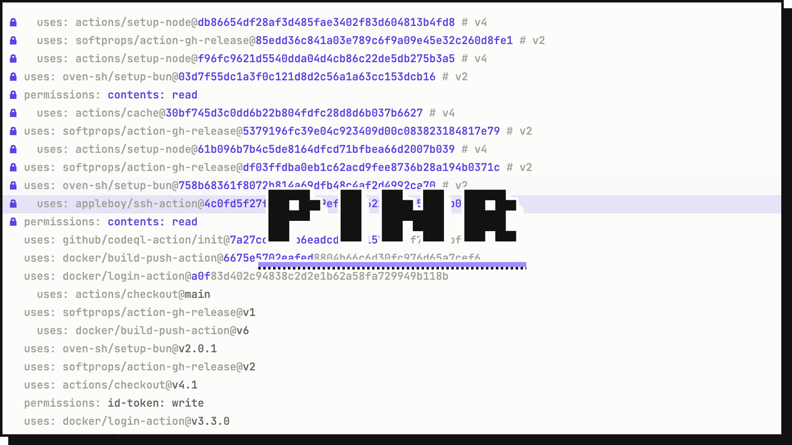

<picture>
  <source media="(prefers-color-scheme: dark)" srcset="docs/banner-dark.gif">
  
</picture>

# pinr

pinr finds every place where a repository pulls in outside code by a reference that can change,
like `actions/checkout@v4` or `FROM node:20`, and pins it to an immutable hash. Git references
become commit SHAs and container images get a digest, so what runs tomorrow is exactly what ran
today.

```diff
- - uses: actions/checkout@v4
+ - uses: actions/checkout@11d5960a326750d5838078e36cf38b85af677262 # v4.4.0
- FROM node:20
+ FROM node:20@sha256:8f693eaa7e0a8e71560c9a82b55fd54c2ae920a2ba5d2cde28bac7d1c01c9ba5
```

pinr only pins the version you already use. Updating pins later is left to Dependabot or
Renovate, which both understand the `@sha # tag` format pinr writes.

## Contents

- [Why pin?](#why-pin)
- [Supported files](#supported-files)
- [Install](#install)
- [Usage](#usage)
- [How pinning works](#how-pinning-works)
- [Warnings](#warnings)
- [Configuration](#configuration)
- [Exit codes](#exit-codes)
- [Limitations](#limitations)
- [Development](#development)

## Why pin?

Tags and branches are mutable. Whoever controls `actions/checkout` or `node` on Docker Hub can
move `v4` or `20` to different code at any time, whether by a normal release, a mistake or a
compromised account. A commit SHA or an image digest always identifies the same content.
Pinning makes builds reproducible and closes a common supply-chain attack path.

## Supported files

| Ecosystem | Files | What gets pinned |
|---|---|---|
| GitHub Actions | `.github/workflows/*.yml`, `action.yml` | `uses:` in steps and reusable workflows, `docker://` actions, `container:` and `services:` images |
| Forgejo Actions | `.forgejo/workflows/*.yml` | Same as GitHub Actions |
| Gitea Actions | `.gitea/workflows/*.yml` | Same as GitHub Actions |
| GitLab CI | `.gitlab-ci.yml`, `*.gitlab-ci.yml` | `image:`, `services:`, `include: project` with `ref:`, `include: component` |
| CircleCI | `.circleci/*.yml` | `docker:` images in jobs, executors and inline orbs |
| Bitbucket Pipelines | `bitbucket-pipelines.yml` | The global `image:`, step images, service images |
| Woodpecker | `.woodpecker.yml`, `.woodpecker/*.yml` | `image:` in `steps`, `services` and `clone`, including plugins |
| Drone | `.drone.yml` | `image:` in `steps` and `services` |
| pre-commit | `.pre-commit-config.yaml` | `rev:` of every hook repository |
| Compose | `compose.yaml`, `docker-compose*.yml` | `services.*.image` |
| Dockerfile | `Dockerfile`, `Containerfile`, `*.Dockerfile` | `FROM`, `COPY --from`, `RUN --mount=from=`, the `# syntax=` directive |
| Podman Quadlet | `*.container`, `*.image`, `*.volume` | `Image=` |

pinr walks the directory recursively and respects `.gitignore`. Things that stay inside the
repository are ignored, such as local actions (`uses: ./…`), build stages (`FROM build`),
`scratch`, references to other Quadlet units (`Image=base.image`) and pre-commit's `local`
and `meta` hooks.

## Install

With Cargo:

```sh
cargo install --git https://github.com/zdrng/pinr
```

From a checkout, using the Nix dev shell:

```sh
git clone https://github.com/zdrng/pinr
cd pinr
nix develop -c cargo install --path .
```

## Usage

```text
pinr [-C <dir>] [check | pin [--dry-run]]
```

| Command | What it does | Network |
|---|---|---|
| `pinr` | Opens the interactive TUI (prints help if stdout is not a terminal) | yes |
| `pinr check` | Lists unpinned references and warnings; fails if anything is unpinned | no |
| `pinr pin` | Resolves and pins every unpinned reference | yes |
| `pinr pin --dry-run` | Shows what `pin` would change without writing | yes |

`-C, --dir <dir>` scans a different directory instead of the current one.

### Interactive TUI

```sh
pinr
```

The TUI opens straight away with the scan results. Each reference is resolved in the
background and its row updates when the result arrives. You pick which references to pin.

```text
┌ pinr ─────────────────────────────────────────────────────┐┌ details ──────────────────────┐
│[x] .github/workflows/ci.yml:8  github.com/actions/checkout ││.github/workflows/ci.yml:8     │
│ ✓  .github/workflows/ci.yml:9  github.com/actions/setup-no ││ecosystem  github-actions      │
│[ ] Dockerfile:2  docker.io/library/golang:1.23             ││reference  github.com/actions/ │
│ ⚠  Dockerfile:4  `alpine:${V}` uses a variable and can't b ││checkout@v4                    │
│ ✗  compose.yaml:3  ghcr.io/acme/private:1                  ││                               │
│ ⠋  compose.yaml:5  quay.io/podman/stable:latest            ││→ 11d5960a3267… (v4.4.0)       │
└────────────────────────────────────────────────────────────┘└───────────────────────────────┘
6 refs · 1 resolving · 1 errors · 1 warnings · 1 selected
↑↓/jk move · space select · a select all · enter pin selected · q quit
```

| Marker | Meaning |
|---|---|
| `[ ]` / `[x]` | Resolved, can be selected |
| `⠋` | Still resolving |
| `✓` | Already pinned |
| `⚠` | Can't be pinned (see [Warnings](#warnings)) |
| `✗` | Resolution failed, e.g. the image doesn't exist or is private |

| Key | Action |
|---|---|
| `↑` `↓` / `j` `k` | Move |
| `space` | Select or deselect the current row |
| `a` | Select or deselect all resolved rows |
| `enter` | Pin the selected rows and exit |
| `q` / `esc` / `ctrl-c` | Quit without changes |

### In CI

`pinr check` works offline and exits non-zero when it finds unpinned references, so it can
guard a repository against new unpinned references:

```yaml
# .github/workflows/pinr.yml
name: pinr
on: [push, pull_request]
jobs:
  check:
    runs-on: ubuntu-latest
    steps:
      - uses: actions/checkout@11d5960a326750d5838078e36cf38b85af677262 # v4.4.0
      - run: cargo install --git https://github.com/zdrng/pinr
      - run: pinr check
```

```text
$ pinr check
warning: Dockerfile:4  `alpine:${V}` uses a variable and can't be pinned
unpinned: .github/workflows/ci.yml:8  github.com/actions/checkout@v4
unpinned: compose.yaml:3  docker.io/library/postgres:16
2 unpinned, 1 warnings
```

### Pin everything

```text
$ pinr pin
.github/workflows/ci.yml:8  github.com/actions/checkout@v4  ->  11d5960a3267… (v4.4.0)
compose.yaml:3  docker.io/library/postgres:16  ->  sha256:ca0bd484cb98…
pinned 2 references in 2 files
```

## How pinning works

### Git references

Actions, reusable workflows, GitLab includes and components and pre-commit hooks are pinned
to the full commit SHA. pinr adds a comment naming the most specific tag on that commit, so
`v4` becomes `# v4.4.0`. Branches keep their name as the comment.

```yaml
- uses: actions/checkout@11d5960a326750d5838078e36cf38b85af677262 # v4.4.0
```

```yaml
include:
  - project: gitlab-org/gitlab-runner
    ref: 44feccdf3a5f65891017ef143a78c7a0d22bb63b # v17.0.0
```

pre-commit gets the `# frozen:` comment that `pre-commit autoupdate --freeze` writes, so
`autoupdate` keeps working:

```yaml
- repo: https://github.com/pre-commit/pre-commit-hooks
  rev: cef0300fd0fc4d2a87a85fa2093c6b283ea36f4b # frozen: v5.0.0
```

Forgejo and Gitea resolve `uses: actions/checkout@v4` against their `DEFAULT_ACTIONS_URL`,
so pinr does the same: `https://data.forgejo.org` for Forgejo and `https://github.com` for
Gitea, unless [configured](#configuration) otherwise. Absolute references like
`uses: https://code.forgejo.org/actions/setup-go@v5` are resolved against the host they name.

How pinr handles an existing comment on the same line:

- A comment that looks like a version (`# v4`, `# tag=v4`, `# frozen: v4`) is replaced.
- Any other comment is kept, and the version is inserted before it:
  `@sha # v4.4.0 # needed for tags`.

pinr resolves refs with one anonymous request per repository to git's smart HTTP endpoint
(`info/refs`), so the GitHub API rate limit doesn't apply. Annotated tags are peeled to the
commit they point to. pinr only ever takes SHAs from the repository's own ref list, never
from a fork.

### Container images

Images keep their tag and get the digest appended. Docker and Podman use the digest and treat
the tag as a readable label. An image without a tag gets an explicit `:latest`.

```dockerfile
FROM golang:1.23@sha256:60deed95d3888cc5e4d9ff8a10c54e5edc008c6ae3fba6187be6fb592e19e8c0 AS build
FROM gcr.io/distroless/static:latest@sha256:…
```

The digest is the one for the manifest list (index), so multi-arch images keep working on
every platform. pinr reads it from a `HEAD` request to the registry's distribution API, using
an anonymous token where the registry asks for one (Docker Hub, GHCR, Quay, …). Docker Hub
doesn't count `HEAD` requests against its pull limits.

Dockerfiles and systemd units don't support trailing comments, which is why images never get one.

### Safe rewriting

pinr never re-serializes a file. Every edit replaces an exact byte range, so formatting, quotes,
comments, key order and line endings stay as they are. Before writing, pinr checks that each
range still holds the text it scanned and refuses to touch files that changed in between.
Files are written to a temporary file and then renamed into place. Running `pinr pin` a second
time changes nothing.

## Warnings

Some references pull in outside code but can't be pinned. pinr reports them instead of
silently skipping them:

| Example | Why |
|---|---|
| `FROM node:${NODE_VERSION}`, `image: $CI_REGISTRY/app`, `image: cimg/base:<< parameters.tag >>` | Uses a variable, so the value is only known at build time |
| `uses: org/action@${{ inputs.ref }}` | Uses a GitHub Actions expression |
| `include: remote: https://…` | Remote includes have no integrity check |
| `include: template: …` | Comes from the GitLab instance itself |
| `include: project: …` without `ref:` | Follows the default branch |
| `component: …@~latest` | Follows the latest release |
| `node: circleci/node@5`, `@volatile` | A CircleCI orb without a full `x.y.z` version follows new releases. Full versions can't change. |
| `repo: git@github.com:org/hooks` in pre-commit | Only `https://` repositories can be resolved |
| `Image=nginx` in a Quadlet | Podman resolves short names through `registries.conf`, which may not mean Docker Hub; use `docker.io/library/nginx` |

Warnings are printed to stderr and don't change the exit code.

## Configuration

pinr works without configuration. To change the defaults, put a `pinr.toml` in the scanned
directory:

```toml
# Host for GitLab `include: project` and `$CI_SERVER_FQDN` in components.
gitlab_host = "gitlab.example.com"   # default: "gitlab.com"

# Where `uses: owner/repo@rev` comes from: the instance's `[actions] DEFAULT_ACTIONS_URL`.
forgejo_actions_url = "https://git.example.com"   # default: "https://data.forgejo.org"
gitea_actions_url = "https://gitea.example.com"   # default: "https://github.com"

# Skip references whose file path or reference contains one of these strings.
ignore = [
  "vendor/",
  "github.com/my-org/",
]
```

## Exit codes

| Command | `0` | `1` |
|---|---|---|
| `pinr check` | Everything is pinned | At least one reference is unpinned |
| `pinr pin` | Every reference was resolved | At least one reference could not be resolved (all others are still pinned) |

## Limitations

- Private registries: credentials from `~/.docker/config.json` or Podman's `auth.json` are
  not read yet, so private images show up as resolution errors.
- pinr doesn't yet verify existing pins, i.e. check that a `# v4.4.0` comment matches its SHA.
- Not followed:
  - YAML aliases and merge keys (`<<: *anchor`)
  - GitHub Docker actions declared with `runs.image`
  - Bitbucket Pipes (`pipe:`)
  - systemd line continuations in Quadlets
  - image names split across lines in a Dockerfile
- Forgejo and Gitea also run `.github/workflows` when their own directory doesn't exist. pinr
  treats those files, like every `action.yml`, as GitHub Actions and resolves short `uses:`
  against github.com.
- GitLab component versions must match a git tag exactly. A partial version like `@1.0` that
  GitLab expands to the latest matching release fails to resolve.

## Development

The dev shell provides the Rust toolchain, clippy, rustfmt, rust-analyzer and the security tools
below:

```sh
nix develop
cargo test
cargo clippy --all-targets
cargo fmt
```

Security checks, all in CI (`ci.yml` on every push, `audit.yml` daily for new advisories):

```sh
nix develop -c cargo audit                                  # known vulnerabilities (RustSec)
nix develop -c cargo deny --locked check advisories bans sources   # deny.toml
nix develop -c scripts/geiger.sh                            # unsafe code in pinr and its dependencies (report only)
nix develop -c scripts/check-reproducible.sh                # release build twice, must be bit for bit identical
```

pinr itself forbids `unsafe` code. Release builds are reproducible: `--locked`, the toolchain
pinned by `flake.lock`, one codegen unit and no symbols (`[profile.release]`), and the script
remaps the source, target and Cargo home directories so no machine paths end up in the binary.

### Architecture

```text
src/
  main.rs            CLI parsing, wires everything together
  discover.rs        finds files and detects their ecosystem
  service.rs         PinService: scan → resolve → plan → apply
  cli.rs, tui.rs     presentation: `check` / `pin` and the TUI
  config.rs          pinr.toml
  domain/            pure logic, no I/O
    model.rs         Occurrence, Reference, Edit
    refs.rs          image reference parsing
    edit.rs          applies byte-range edits
    extract/         one Extractor per file format
  provider/          one Provider per protocol
    mod.rs           Provider trait, Resolution
    git.rs, oci.rs   tags → commit SHAs / digests, and how pins are written
  infra/             I/O behind traits
    http.rs, fs.rs   Http and FileSystem traits + real implementations
```

The project is built along two independent axes:

- **Extractors** (one per file format) find references and know nothing about resolving.
- **Providers** (one per protocol: git, OCI) resolve references and know nothing about file
  formats. They only say which bytes to replace. The file format only decides how a version
  comment next to a git SHA looks (`# v4.4.0` or pre-commit's `# frozen: v4.4.0`).

Both meet at the `Reference` type, so an image found in a Compose file and one found in a
Dockerfile go through the same code, and GitHub Actions, GitLab includes and pre-commit share the git
provider.

A `Provider` has a `Ref` type (what extractors find) and a `Pin` type (what it resolves to).
`Resolution` keeps the pin with the reference it was resolved from, so the two can't be mixed
up with another provider's.

### Adding a file format

1. Add a variant to `Ecosystem` in `domain/model.rs` and detect its files in `discover.rs`.
2. Implement `Extractor` in `domain/extract/<format>.rs`. It returns `Found` values whose span
   is exactly the text to replace (only the revision for git refs, the whole image for images).
3. Register it in `extract::for_ecosystem`. The compiler points out every `match` that still
   needs the new variant.
4. If the format writes version comments next to git SHAs differently, say so in
   `Ecosystem::version_comment`.

### Adding a provider

1. Add the reference type to `domain/model.rs` and a variant for it to `Reference`, and
   construct it in the extractors that find it.
2. Implement `Provider` in `provider/<name>.rs`: `resolve` asks the remote for the pin,
   `replacements` says how the pin is written into the file.
3. Map the new `Reference` variant to the provider in `PinService::resolve`. The compiler
   points out every other `match` that needs it.

### Tests

- Every extractor and provider has unit tests with inline fixtures.
- `src/functional_tests.rs` runs a whole project with several ecosystems through the service:
  file contents come from `MockFs`, registry and git responses from `MockHttp`. No test touches
  the network or the disk.
